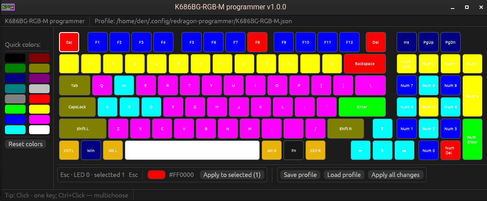

# redragon — K686BG-RGB-M RGB Programmer

Desktop application for programming per-key RGB lighting on the **Redragon K686BG-RGB-M** mechanical keyboard via HID.



## Features

- **Per-key color editor** — visual keyboard layout with interactive key selection.
- **Multi-key selection** — single-click selects one key, `Ctrl+click` toggles multiple keys.
- **Quick colors palette** — 16 preset colors in the left sidebar for rapid assignment.
- **Color picker** — native RGB color editor for fine-grained color control.
- **Color profiles** — save and load custom color profiles as JSON files.
- **Two hardware slots** — write colors to slot 1 (user profile), read both slots.
- **Dark theme** — built-in dark UI with large, readable fonts.

## Hardware

| Property       | Value       |
| -------------- | ----------- |
| Vendor ID      | `0x2E3C`    |
| Product ID     | `0xC365`    |
| Interface      | 2 (vendor)  |
| Report ID      | 1           |
| Report length  | 64 bytes    |
| RGB table size | 396 bytes   |

The keyboard exposes a vendor HID interface used to read/write 132 per-key RGB values (3 bytes per key × 132 keys). Two hardware memory slots are supported; this tool programs **slot 1**.

## Installation

### Prerequisites (Linux)

HID access requires either root privileges or udev rules. Create `/etc/udev/rules.d/99-redragon.rules`:

```
SUBSYSTEM=="hidraw", KERNEL=="hidraw*", ATTRS{idVendor}=="2e3c", ATTRS{idProduct}=="c365", MODE="0660", GROUP="input", TAG+="uaccess"
```

Then reload:

```bash
sudo udevadm control --reload-rules
sudo udevadm trigger
```

### Build

```bash
cargo build --release
```

The binary is located at `target/release/redragon`.

## Usage

### Graphical interface

1. Connect the keyboard via USB.
2. Launch the application.
3. Click keys (or `Ctrl+click` for multi-selection) on the layout.
4. Pick a color from the left panel or use the color picker.
5. Press **Apply to selected** to write to the device.
6. Save the profile to disk when done.

### CLI: probe device

Check whether the keyboard is readable:

```bash
redragon --probe-device
```

Output example:

```
RGB slot 0: 396 bytes read, 396 non-zero bytes
RGB slot 1: 396 bytes read, 396 non-zero bytes
```

Non-zero byte count of `0` means the slot is unprogrammed.

## Configuration

Two files are stored in the user config directory:

| File | Path | Description |
| ---- | ---- | ----------- |
| App config | `~/.config/redragon-programmer/K686BG-RGB-M.toml` | Window size, position |
| Profile | `~/.config/redragon-programmer/K686BG-RGB-M.json` | Per-key color map |

The profile is auto-created on first launch with a default color set.

## Architecture

```
src/
├── main.rs          — CLI entry point, window options, startup
├── ui.rs            — egui layout: keyboard canvas, panels, buttons
├── config.rs        — TOML config (window state), profile path
├── functions.rs     — HID communication: open device, read/write slots
└── rgb.rs           — RGB color struct with egui ↔ RGB conversion
```

- **`eframe`** — native desktop framework (wgpu/glow backend).
- **`hidapi`** — raw USB HID device access.
- **`serde`** / **`serde_json`** / **`toml`** — data serialization.
- **`dirs`** — cross-platform config directory detection.

## License

MIT
